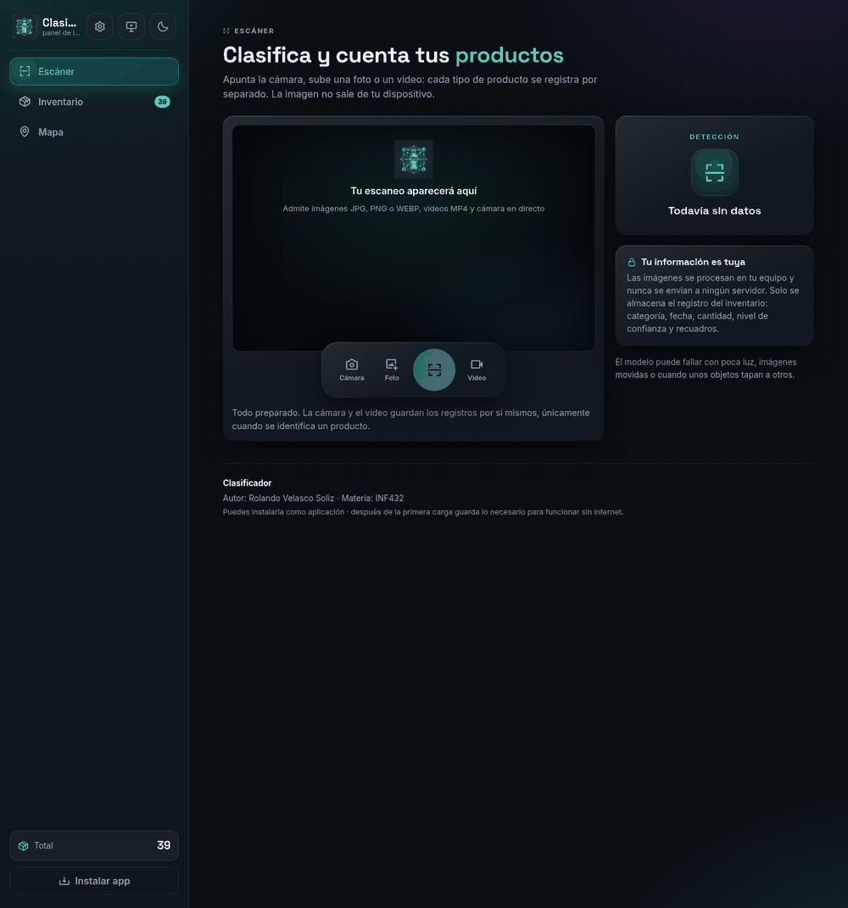
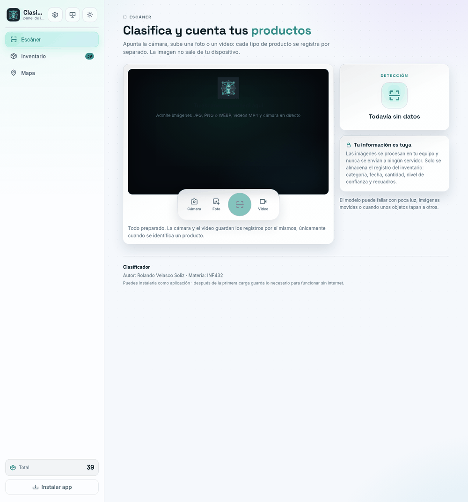
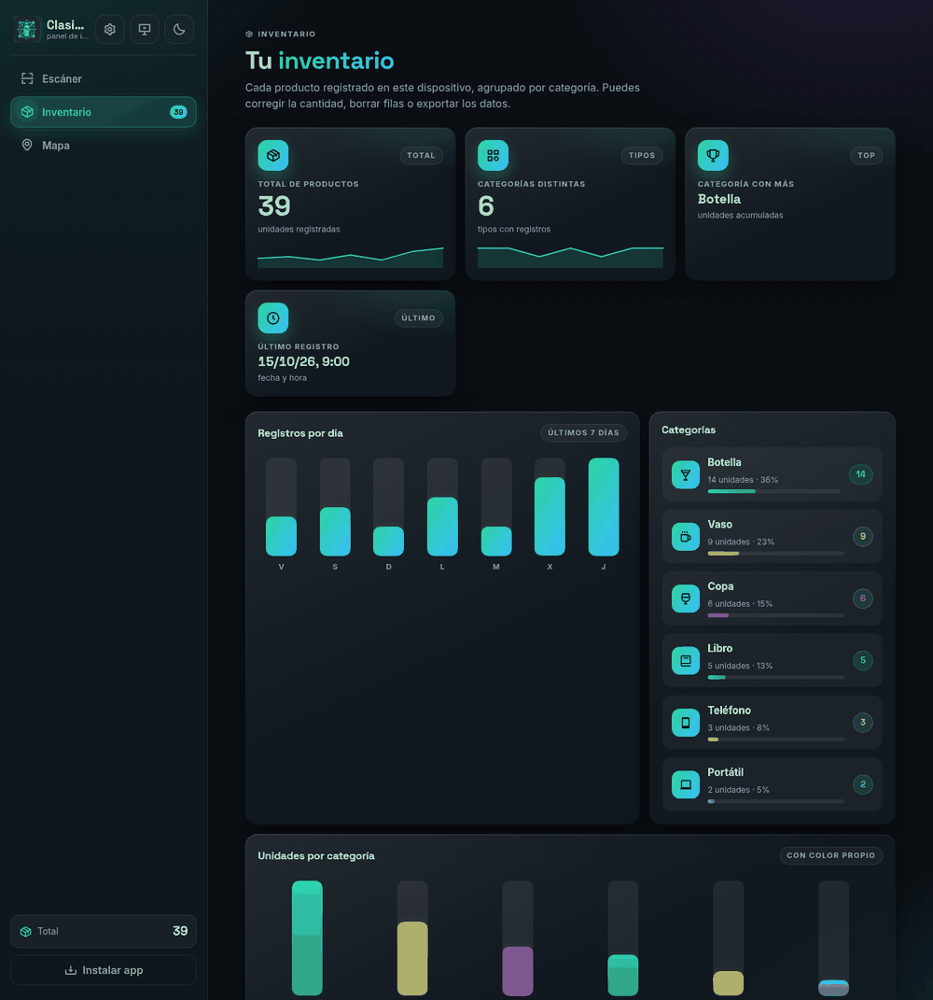
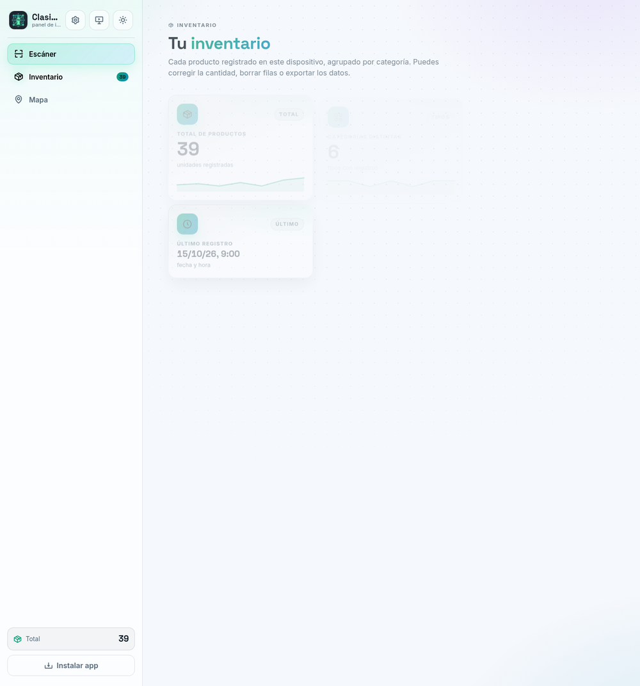
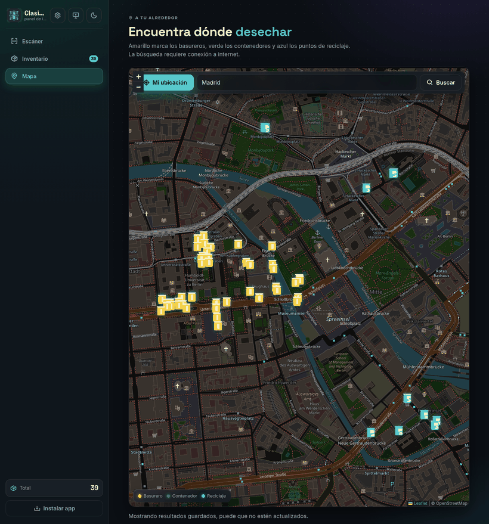
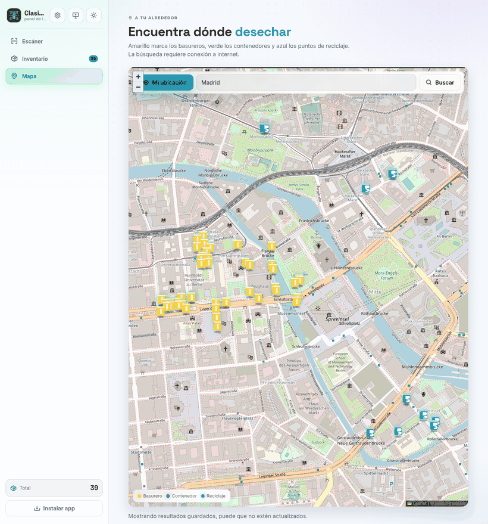

# Clasificador

Clasificador de productos con inventario automático, que se ejecuta íntegramente en el navegador.

[](#)
[](#)
[](#)
[](#)
[](#)
[](#)

<p align="center">
  
</p>

## Capturas

Interfaz en tema oscuro (arriba) y tema claro (abajo).

| Vista | Oscuro | Claro |
|---|---|---|
| Escáner |  |  |
| Inventario |  |  |
| Mapa |  |  |

> Las capturas del inventario usan datos de ejemplo sembrados a propósito. La del mapa muestra
> Berlín con 56 puntos reales de OpenStreetMap (45 basureros y 11 puntos de reciclaje).

## Qué hace

- Detección de hasta **80 tipos de objeto** con IA (COCO-SSD), por cámara, foto o video.
- **Conteo por categoría**: cada objeto cuenta por separado y no se vuelve a registrar mientras siga a la vista.
- **Inventario con historial** por categoría, con la cantidad editable y la confianza de cada registro.
- **Categorías configurables** y **sensibilidad ajustable** desde Ajustes (qué detectar y cuán estricto ser).
- **Exportación** del inventario a **CSV** y **JSON**.
- **Mapa** de basureros y puntos de reciclaje cercanos (1200 m).
- **Tema claro/oscuro**.
- **Instalable como PWA** y con **uso sin conexión** tras la primera carga.

## Cómo funciona

1. El usuario apunta con la **cámara**, sube una **foto** o un **video**.
2. **COCO-SSD** (sobre TensorFlow.js) dibuja las cajas y clasifica cada objeto en su categoría.
3. Un **rastreo anti-duplicado por categoría** compara las cajas entre pasadas (solapamiento IoU ≥ 0.45)
   y exige ver el objeto dos veces seguidas en cámara antes de contarlo, para no repetir el mismo producto.
4. Cada registro se guarda en el **inventario del navegador** (`localStorage`), con fecha, categoría,
   cantidad y confianza.
5. La app incluye además una **red propia** entrenada en `modelo/` que actúa como confirmación extra
   para la clase **Botella** (entrada gris de 100×100). Si los pesos no están disponibles, la app sigue
   funcionando solo con COCO-SSD.

## Privacidad

Las imágenes se procesan **en el equipo** y no se envían a ningún servidor. El inventario vive en el
`localStorage` del navegador. La única conexión que sale a internet (aparte de cargar las librerías) es
la del **mapa**: la ciudad o dirección que escribas se consulta a OpenStreetMap para localizar los puntos
cercanos.

## Tecnologías

- **TensorFlow.js** 4.22.0 y **COCO-SSD** 2.2.3 para la detección de objetos en el navegador.
- **Leaflet** 1.9.4 con datos de **OpenStreetMap** (**Overpass** para los puntos y **Nominatim** para geocodificar).
- **Boxicons** 2.1.4 para los iconos.
- **Google Fonts** (Space Grotesk e Inter) para la tipografía.

## Estructura del proyecto

```
Clasificador/
├── index.html               Página única con las tres vistas (Escáner, Inventario y Mapa)
├── styles.css               Estilos y variables de tema (oscuro/claro)
├── service-worker.js        Caché para el uso sin conexión
├── manifest.webmanifest     Metadatos de la PWA (nombre, iconos, colores)
├── README.md                Este documento
├── assets/                  Logotipo, iconos de la PWA y favicon
│   ├── logo.png
│   ├── logo-hero.png
│   ├── icono.png
│   ├── icon-192.png
│   ├── icon-maskable-512.png
│   └── favicon.png
├── js/
│   ├── categorias.js        Catálogo de las 80 categorías (nombre, icono, color, activa)
│   └── mapa.js              Mapa: varios servidores Overpass, reintentos y caché por zona
├── modelo/                  Red propia de TensorFlow.js (confirmación de Botella)
│   ├── model.json           Arquitectura + manifiesto de pesos
│   ├── group1-shard1of2.bin Pesos (parte 1)
│   └── group1-shard2of2.bin Pesos (parte 2)
└── docs/
    └── capturas/            Capturas de pantalla usadas en este README
```

El conjunto de datos y el script de entrenamiento de la red propia se mantienen **fuera** de este
repositorio (por su tamaño), en `../clasificador-datos/`.

## Instalación y uso local

```bash
git clone <URL-del-repositorio>
cd Clasificador
python3 -m http.server 8765
```

Abre <http://127.0.0.1:8765> en el navegador. Si el puerto está ocupado, cambie el número.

> La **cámara** y el **service worker** (uso sin conexión e instalación) necesitan un origen seguro:
> `http://localhost`, `http://127.0.0.1` o `https://`. Abrir `index.html` con doble clic (`file://`)
> no habilita esas funciones.

## Despliegue

Al ser un sitio 100 % estático, se puede publicar en **GitHub Pages** sirviendo la raíz del repositorio.
URL del proyecto: _(próximamente)_.

## Limitaciones conocidas

- COCO-SSD reconoce **tipos de objeto**, no marcas ni productos concretos.
- La precisión baja con **poca luz** o cuando los objetos están **tapados**.
- El **mapa** depende de servidores públicos de Overpass que a veces se saturan; la app reintenta con
  varios y guarda los resultados en caché para no dejar la búsqueda en blanco.

## Próximos pasos

- Escáner de códigos de barras.
- Catálogo con precios y valor del inventario.
- Alertas de stock mínimo.
- Reportes en PDF o Excel.

## Créditos y atribución

- Datos del mapa © [colaboradores de OpenStreetMap](https://www.openstreetmap.org/copyright).
- [TensorFlow.js](https://www.tensorflow.org/js) y [COCO-SSD](https://github.com/tensorflow/tfjs-models/tree/master/coco-ssd).
- [Leaflet](https://leafletjs.com/), [Boxicons](https://boxicons.com/) y [Google Fonts](https://fonts.google.com/).

---

Autor: **Rolando Velasco Soliz** · Materia: **INF432**
